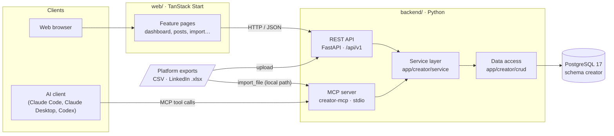

# System overview

Creator Analytics is a self-hosted, single-user application. It has three parts that run on your own machine:

| Component | Location | Role |
|---|---|---|
| Web app | `web/` | TanStack Start dashboard. Reads and writes data only through the REST API. |
| Backend | `backend/` | One Python package with two entry points: the FastAPI REST API and the MCP server. Both call the same service layer. |
| Database | `docker-compose.yml` | PostgreSQL 17. All data lives in the `creator` schema, created by Alembic migrations. |

There are no background workers, queues, schedulers or outbound connections to the social platforms. Data enters the
database only when you import a file, edit data in the web app, or an AI client calls an MCP tool.

## Diagram



## Backend

The backend follows the layering of
[fastapi-best-architecture](https://github.com/fastapi-practices/fastapi-best-architecture):

```text
backend/
  main.py                    app = register_app()
  core/                      conf.py (settings from env / backend/.env), registrar.py (CORS, routers, exception handlers)
  database/db.py             SQLAlchemy async engine (psycopg 3) and per-request transaction dependencies
  common/                    error types and the {"code", "msg", "data"} response envelope
  app/router.py              mounts every app module under /api/v1
  app/mcp_server.py          MCP tools and prompts; they call the same services as the REST API
  app/creator/
    api/v1/                  thin REST endpoints: meta, tables, sync, imports, dashboard
    schema/                  Pydantic request models
    service/                 business logic and transactions
    crud/                    SQL, one data-access object per table or aggregate
    model/                   SQLAlchemy models (used by Alembic)
    utils/, tests/
  alembic/                   migrations: schema, views and the seeded metric catalogue
  scripts/seed_demo.py       invented data for a separate creator_demo database
```

### One service layer, two entry points

The REST API (`app/creator/api/v1/`) and the MCP server (`app/mcp_server.py`) are both thin. Each REST request and each
MCP tool call opens one database transaction and delegates to a service in `app/creator/service/`:

| Service | Used for |
|---|---|
| `table_service` | Generic create / read / update / delete on any table, and the schema description. Driven by `pg_catalog`, so new tables need no new endpoints. |
| `sync_service` | Snapshot syncs of posts, account metrics, revenue and follower lists. Resolves metric names and records an `import_batches` row. |
| `import_service` | CSV and LinkedIn `.xlsx` imports, including the dry-run preview. Builds on `sync_service`. |
| `linkedin_service` | Parses the LinkedIn analytics export. |
| `dashboard_service` | Overview numbers, metric time series and expiring history. |
| `brief_service` | Posts without a content brief and the vocabulary already used in briefs. |

Because of this, an AI agent and the web app get the same validation, the same upsert rules and the same provenance
records.

### REST API

Everything lives under `/api/v1` and returns `{"code": 200, "msg": "Success", "data": …}`. Errors use the same shape
with the HTTP status as `code`. Interactive documentation is served at `http://localhost:8000/docs`.

| Endpoint | Purpose |
|---|---|
| `GET /health` | Database reachable |
| `GET /schema` | Tables, columns, primary keys and enum values |
| `GET · POST · PATCH · DELETE /tables/{table}` | Generic CRUD. Filters: `?col=v`, `?col__gte=v`, `__like`, `__isnull`… PATCH and DELETE take the primary key as query parameters. |
| `POST /sync/content`, `/sync/account-metrics`, `/sync/revenue`, `/sync/relationships` | Snapshot syncs |
| `POST /imports/preview` | Dry run of an import: exact counts, nothing stored |
| `POST /imports` | Import a CSV export or the LinkedIn analytics `.xlsx` |
| `GET /dashboard/overview`, `/dashboard/expiring`, `/dashboard/timeseries` | Dashboard data |

### MCP server

`creator-mcp` (declared in `backend/pyproject.toml`) starts an MCP server over stdio using the official
[MCP Python SDK](https://github.com/modelcontextprotocol/python-sdk). The client launches it as a subprocess; it does not
listen on a network port. See the [MCP setup guide](../guides/mcp-setup.md) for the tools and client configuration.

## Data model

Metrics are stored as long, narrow facts keyed by a metric catalogue, so a new platform metric is a new catalogue row,
not a new column.

| Table or view | Holds |
|---|---|
| `accounts` | One row per social account (platform, handle, type) |
| `metric_definitions` | The catalogue: every metric per platform and scope, its GUI label, how long the platform keeps it and where to export it. Seeded by migrations. |
| `content_items` | Posts and videos, upserted by `(platform, external_id)` |
| `content_metric_facts`, `account_metric_facts`, `breakdown_facts`, `revenue_facts` | Metric values with their period |
| `content_briefs` | The creative decisions behind a post, versioned; written by hand or by an agent, never by imports |
| `people`, `relationships` | Follower / connection lists, with inferred unfollows |
| `import_batches` | Provenance: every import or sync, its source and the file's SHA-256 |
| `v_content_performance`, `v_content_summary`, `v_content_latest_metrics`, `v_expiring_metrics`, `v_inferred_unfollows` | Read-only views used by the dashboard and available to agents |

The schema also contains tables for comments, conversations, live sessions and retention curves; they are reachable
through the generic table endpoints and MCP tools.

### Provenance and deferred foreign keys

Every fact row points at the `import_batches` row that created it. These foreign keys are
`DEFERRABLE INITIALLY DEFERRED` (see the initial Alembic migration). Without that, deleting an account that has imported
data fails: Postgres checks the batch foreign key before the nested cascade (account → content → facts) has removed the
facts. A batch that still has facts cannot be deleted on its own.

## Web app

```text
web/src/
  routes/                    thin: search validation, loader, and the feature's page component
  features/<name>/           dashboard, accounts, content, imports, metrics, explorer, audience, earnings
    api/                     query keys, service calls, queryOptions, mutation hooks
    components/              feature UI, exported through components/index.ts
    types/                   feature types and search-param validators
    index.ts                 the feature's public API: import features only through it
  shared/
    components/ui/           shadcn/ui primitives
    components/common/       app-wide components (Rail, DataTable, Sounding, PlatformBadge…)
    lib/                     api-client.ts (the single HTTP client), formatting, navigation
    styles/globals.css       design tokens, light and dark
```

The web app talks to the backend through `shared/lib/api-client.ts` (axios, base URL `VITE_API_URL` + `/api/v1`) and
caches responses with TanStack Query.

## Main data flows

**Importing an export from the web app**

1. The user picks an account and drops a file on the Import page.
2. The web app sends it to `POST /imports/preview`. The backend runs the import inside a transaction, returns the exact
   counts and rolls back.
3. On confirmation, `POST /imports` runs the same code and commits. Posts are upserted, facts are written and one
   `import_batches` row records the source and the file hash.

**An AI agent adding data**

1. The client starts `creator-mcp` and lists its tools.
2. The agent calls `describe_schema`, then for example `sync_content` or `create_rows`.
3. The tool opens a transaction and calls the same service the REST API uses. The result is returned to the agent as
   JSON, and the web app shows the new data on its next request.

**Seeing what is about to expire**

`dashboard_service.expiring` (with `app/creator/utils/expiry.py`) compares the history each account has saved with how
long the platform keeps each metric (`metric_definitions`), and sorts the result by urgency. The dashboard's "Expiring
soon" panel (`GET /dashboard/expiring`) and the `expiring_metrics` MCP tool both call it.
